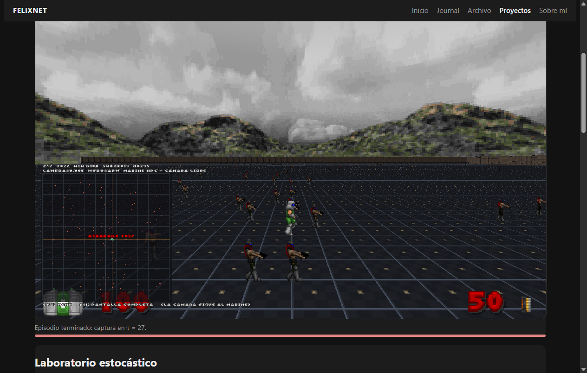
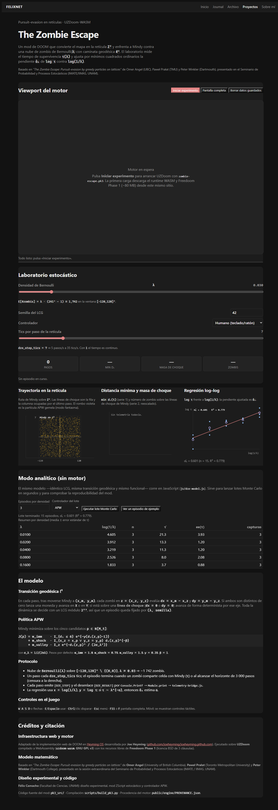

# The Zombie Escape — evasión de obstáculos en la retícula Z² (edición web)

Mod experimental para **UZDoom** (familia GZDoom) compilado a WebAssembly, que
convierte un mapa de DOOM en la retícula **Z²** y enfrenta a *Mindy* (el jugador)
contra una nube de zombis de Bernoulli(λ) con **caminata geodésica ℓ¹**.
Alrededor del motor hay un **laboratorio estocástico** que mide el tiempo de
supervivencia τ(λ), lo grafica en vivo y ajusta la pendiente α̂₁ de
`log τ` frente a `log(1/λ)` por mínimos cuadrados ordinarios.

> Marco teórico: *“The Zombie Escape: Pursuit-evasion by greedy particles on
> lattices”*, **Omer Angel** (UBC), **Paweł Prałat** (TMU) y **Peter Winkler**
> (Dartmouth), presentado en el Seminario de Probabilidad y Procesos
> Estocásticos (IMATE / IIMAS, UNAM).



---

## 1. Arranque rápido

Requisitos: `git`, Python ≥ 3.9, Node ≥ 20 para las pruebas (Node ≥ 22 para
`scripts/e2e-headless.mjs`, que usa `WebSocket` global) y `make` *o*
PowerShell 5.1+/PowerShell 7 en Windows.

```bash
make bootstrap     # clona SOLO joeheyming/doom/ -> public/engine/ (~80 MB)
make build-pk3     # genera public/mods/zombie-escape.pk3
make test          # verifica el WAD/pk3 + pruebas unitarias de node
make serve         # http://localhost:8080/demos/DOOM-ZombieEscape/public/
```

En Windows sin `make`:

```powershell
powershell -ExecutionPolicy Bypass -File scripts/bootstrap_infra.ps1
python scripts/build_pk3.py
node --test "tests/*.test.js"
python scripts/serve.py
```

Abre la URL, pulsa **Iniciar experimento** y espera la primera carga (el motor
descarga su paquete WASM de ~80 MB desde el propio sitio). El Service Worker
`coi-serviceworker.js` inyecta las cabeceras COOP/COEP que necesita
`SharedArrayBuffer`; `scripts/serve.py` las manda directamente en local.

---

## 2. Estructura

```text
demos/DOOM-ZombieEscape/
├── README.md                     este documento
├── LICENSE                       GPL v3 (motor y mod)
├── NOTICE.md                     atribuciones y licencias de terceros
├── Makefile                      bootstrap / build-pk3 / test / serve / e2e / audit-bot
├── scripts/
│   ├── bootstrap_infra.sh        clon selectivo de joeheyming/doom/ (POSIX)
│   ├── bootstrap_infra.ps1       equivalente Windows/PowerShell
│   ├── build_pk3.py              MAP01.wad binario + texturas + pk3
│   ├── serve.py                  servidor local con COOP/COEP
│   ├── e2e-headless.mjs          prueba de humo con Chrome headless (CDP)
│   ├── check-bot.mjs             auditoría del control de Mindy (modos 1 y 2)
│   └── debug-traza.mjs           compara la traza del motor con el gemelo JS
├── pk3_src/
│   ├── MAPINFO.txt               registro del EventHandler y de MAP01
│   ├── CVARINFO.txt              dze_lambda, dze_seed, dze_controller, dze_step_tics
│   ├── ZSCRIPT.zc                punto de entrada + #include
│   └── zscript/
│       ├── dze_constants.zc      dimensiones de Z², pesos de J, exp/ln propios
│       ├── dze_zombie.zc         actores LatticeZombie y DZEGhost
│       ├── dze_mindy_bot.zc      política APW y línea base Greedy ℓ¹
│       ├── dze_controller.zc     LCG, nube, transición ℓ¹, telemetría JSON
│       └── dze_hud.zc            radar táctico 2D con líneas de choque
├── public/
│   ├── index.html                viewport + laboratorio + citaciones
│   ├── coi-serviceworker.js      aislamiento COOP/COEP (heredado de joeheyming)
│   ├── css/lab.css               estilos (solo tokens de ../../../css/demos.css)
│   ├── js/
│   │   ├── dze-loader.js         arranque del motor y argumentos del experimento
│   │   ├── telemetry-bridge.js   parser de [DZE_*] + MCO
│   │   ├── plots.js              trayectoria, series temporales y regresión
│   │   ├── dze-model.js          gemelo JS del modelo (modo analítico)
│   │   └── app.js                cableado de la UI
│   ├── mods/zombie-escape.pk3    artefacto compilado
│   └── engine/                   runtime UZDoom-WASM + Freedoom + PROVENANCE.json
└── tests/                        node --test (parser, MCO, modelo)
```

---

## 3. El modelo

### 3.1 Retícula y mapa

`scripts/build_pk3.py` genera un `MAP01.wad` binario *sin* editor ni nodebuilder:
una sala convexa de 16384 × 16384 map units (celdas de 64 × 64, es decir
256 × 256 celdas de Z²), un solo sector, cuatro paredes y un BSP de dos
subsectores escrito a mano (más `BLOCKMAP`, `REJECT` y `THINGS`).
Las texturas del mod se generan como PNG **en el propio script**:

| lump | uso |
| --- | --- |
| `flats/DZEFLOOR.png` | cuadrícula 64×64 con aristas marcadas y un punto en cada nodo de Z² |
| `flats/DZECEIL.png` | techo oscuro |
| `textures/DZEWALL.png` | pared de ladrillo técnico |

El jugador (*Mindy*) arranca en `(0,0)`. Su celda es
`round(pos / 64)`; la nube vive en `[-120,120]² \ {(0,0)}`.

### 3.2 Nube de Bernoulli y LCG

Un LCG de *Numerical Recipes* fija todo el experimento:

```text
x_{n+1} = 1664525 · x_n + 1013904223   (mod 2^32)
u       = (x >> 8) / 2^24
semilla = dze_seed · 2654435761 + 1013904223
```

Se recorre `x = -120..120` y, para cada `x`, `y = -120..120` (saltando el
origen); se añade un zombi cuando `u < λ`. El **mismo** orden y las **mismas**
constantes están implementados en `public/js/dze-model.js`, así que un par
`(λ, semilla)` define el episodio en el motor y en el modo analítico.

### 3.3 Transición geodésica ℓ¹

En cada paso, **después** de que Mindy se mueva a `(x_m, y_m)`, cada zombi en
`z = (x_z, y_z)` calcula `dx = x_m − x_z`, `dy = y_m − y_z` y:

* si `dx ≠ 0` y `dy ≠ 0` → lanza una moneda (bit 16 del LCG) y avanza **una**
  celda en X o en Y;
* si está sobre una **línea de choque** (`dx = 0` o `dy = 0`) → avanza de forma
  determinista por ese eje.

Siempre hacia Mindy, y todos los zombis comparten el flujo del LCG en el orden
del arreglo.

### 3.4 Política APW

Mindy elige entre los cinco candidatos `p ∈ N[M_t] = {(0,0), (±1,0), (0,±1)}`
el que minimiza

```text
J(p) = w_imm    · Σ_{d₁(z,p) ≤ 6} exp(−γ (d₁(z,p) − 1))
     + w_shock  · Σ_{x_z = x_p ∨ y_z = y_p} d₁(z,p)^{−β}
     + w_valley · Σ_z exp(−d₁(z,p)² / (2σ_λ²))
```

con `σ_λ = 1/√(2πλ)`, de modo que `2σ_λ² = 1/(πλ)` y el núcleo gaussiano se
evalúa como `exp(−π λ d²)`. Parámetros (`pk3_src/zscript/dze_constants.zc`):

| símbolo | valor | función |
| --- | --- | --- |
| `w_imm` | 1.00 | penaliza la inmediatez (zombis a ≤ 6 celdas) |
| `w_shock` | 0.75 | castiga pisar una fila/columna ocupada (línea de choque) |
| `w_valley` | 1.50 | empuja hacia los valles de densidad de Poisson |
| `γ` | 0.35 | decaimiento del término inmediato |
| `β` | 1.00 | exponente del término de choque (armónico) |
| corte de valle | `exp(−12) ≈ 6·10⁻⁶` | trunca la suma sobre la nube completa |
| corte de choque | `d₁ ≤ 64` | trunca la suma sobre la línea |

Los empates se rompen rotando el orden de evaluación con `rngState mod 5`, y se
tratan como empate las diferencias menores que `10⁻⁹` (tolerancia numérica
compartida con el gemelo JS). Una celda ocupada por un zombi tiene coste
`10³⁰`: es un movimiento prohibido.

La línea base **Greedy ℓ¹** (controlador 2) maximiza la distancia al zombi más
cercano y, en caso de empate, la suma de distancias a los zombis dentro del
radio de choque.

### 3.5 Captura y horizonte

Mindy queda atrapada cuando algún zombi comparte su celda (`d₁ = 0`) al final
de un paso. `τ` es el número de pasos hasta la captura; si se alcanza
`DZE_MAX_STEPS = 3000`, el episodio se **censura a la derecha** y se emite
`"censored":1`.

Con la geometría de la especificación (nube en `±120` dentro de una sala de
`±128`) y velocidades 1:1, τ está dominado por la distancia al zombi más
cercano, que escala como `λ^{−1/2}` en dimensión 2:

```text
E[τ] ≈ c · λ^{−1/2}   ⇒   α = 1/2
```

Por eso λ = 0.03 (≈1 742 zombis) produce capturas en ~3 pasos, mientras que
λ = 0.005 (≈295 zombis) permite episodios de ~30 pasos. El laboratorio lo hace
explícito: la regresión sobre λ ∈ {0.01 … 0.16} devuelve α̂₁ ≈ 0.5.

### 3.6 Modo fantasma

Con `dze_controller = 3` el jugador humano se mueve libremente y el controlador
simula en paralelo una segunda partícula `M_t^APW` sobre la **misma** nube, la
dibuja como rombo violeta en el radar y como actor translúcido en 3D
(`DZEGhost`). Así se compara en vivo la trayectoria humana con la teórica.

---

## 4. Telemetría

Cada paso emite una línea JSON por `Console.Printf`, que en el build WASM
termina en `Module.print` y la captura `public/js/telemetry-bridge.js`:

```text
[DZE_BOOT]   {"lambda":F,"seed":I,"controller":I,"step_tics":I,"zombies":I,"actors":I,"radius":I,"hash":I}
[DZE_STEP]   {"t":I,"mx":I,"my":I,"min_d1":I,"shock":I,"n":I,"caught":I,
              "ax":I,"ay":I,"drift":I,"stay":I,"h":I,"in":I,"still":I}
[DZE_RESULT] {"caught":I,"tau":I,"lambda":F,"seed":I,"controller":I,"zombies":I,"steps":I,"censored":I}
```

* `mx, my` — celda que decidió el algoritmo; `min_d1` — distancia ℓ¹ al zombi
  más cercano; `shock` — zombis sobre la fila o la columna de Mindy (masa de
  choque);
* `ax, ay` — celda medida sobre la malla del marine **al iniciar el paso**
  (con animación continua la malla va a medio camino dentro del paso, así que
  lo comprobable es que al empezar estuviera donde la dejó el paso anterior);
* `hash`/`h` — checksum FNV‑1a de la nube (boot) y tras cada paso: permite
  comparar el estado con el gemelo JS bit a bit;
* `in` — tics en los que la interfaz humana pidió movimiento. En los modos
  automáticos se cuenta y se **suprime** (ver §7);
* `still` — pasos consecutivos sin cambiar de celda (sólo modos humanos; el HUD
  avisa a los 30 con «SIN MOVIMIENTO»).

El puente reensambla líneas partidas, valida claves mínimas, guarda un
histórico acotado y expone `parseLine`, `linearRegression`, `fitLogLog` y
`summarizeByLambda`, que son exactamente lo que prueban los tests.

---

## 5. Laboratorio web




* **Viewport**: el canvas del motor (`+map MAP01`), con pantalla completa y
  pointer-lock. Los controles del laboratorio se traducen a
  `+set dze_lambda … +set dze_seed … +set dze_controller … +set dze_step_tics …`,
  tal como pide la especificación §5.
* **Laboratorio estocástico**: λ, semilla, controlador y tics por paso; cifras
  en vivo (pasos, `min d₁`, masa de choque, número de zombis y **celda del
  marine**), con un aviso que explica quién mueve al personaje según el
  controlador elegido.
* **Gráficas**: trayectoria del marine sobre Z² (con líneas de choque y, si
  corres un episodio de ejemplo, la nube completa), series de `min d₁(t)` y
  masa de choque, y la regresión log–log con α̂₁.
* **Modo analítico**: el mismo modelo en JS corre lotes Monte Carlo sin motor
  (`runBatch`), llena la tabla por densidad y ajusta α̂₁. Sirve también cuando
  `public/engine/` todavía no existe.
* **Reiniciar con estos parámetros**: el runtime WASM no se puede reiniciar,
  así que el botón recarga la página con la configuración en la URL
  (`?lambda=…&seed=…&controller=…&tics=…&auto=1`).

---

## 6. Criterios de aceptación (especificación §6)

| # | Criterio | Dónde se cumple | Cómo verificarlo |
| --- | --- | --- | --- |
| 1 | `make bootstrap` baja solo `/doom/`, elimina los mods de franquicias y genera `PROVENANCE.json` | `scripts/bootstrap_infra.{sh,ps1}` | `make bootstrap` y revisar `public/engine/PROVENANCE.json` |
| 2 | `make build-pk3` genera `MAP01.wad` con cabeceras `PWAD` válidas y compila el `.pk3` | `scripts/build_pk3.py` | `make build-pk3` (el script verifica ~36 000 invariantes del WAD y el contenido del pk3) |
| 3 | Pruebas de `node --test` para el parser `[DZE_STEP]`/`[DZE_RESULT]` y la pendiente α̂₁ por MCO sobre `(log(1/λ), log τ)` | `tests/telemetry.test.js`, `tests/model.test.js` | `make test` |
| 4 | `make serve` levanta `http://localhost:8080`, registra el Service Worker de `SharedArrayBuffer` y permite jugar o correr el bot APW | `scripts/serve.py`, `public/coi-serviceworker.js` | `make serve` y abrir la URL |
| 5 | El algoritmo conduce de verdad al marine NPC (modos 1 y 2) y el jugador solo observa | `dze_controller.zc` (teleport por celda + `DZEFreecam`), `scripts/check-bot.mjs` | `make audit-bot` |

Comprobación adicional de extremo a extremo (sin interacción humana):

```bash
node scripts/e2e-headless.mjs \
  --url "http://127.0.0.1:8080/demos/DOOM-ZombieEscape/public/?lambda=0.005&seed=7&controller=1&auto=1" \
  --seconds 60 --screenshot build/e2e.png
```

Arranca Chrome headless con el protocolo DevTools, recoge consola y excepciones,
y falla si aparece un `Script error` de ZScript o una excepción de JavaScript.

### Auditoría del control del marine


`make audit-bot` corre el motor con los controladores 1 (APW) y 2 (Greedy) y
compara la traza real del marine con el modelo de referencia:

```bash
node scripts/check-bot.mjs build/bot-apw.json --controller 1
```

Verifica, sobre los datos del motor:

* que la malla del marine está, al empezar cada paso, en la celda que dejó el
  paso anterior (`ax, ay` frente a la celda previa) — con movimiento continuo
  la malla va a medio camino dentro del paso, así que ésa es la invariante; el
  contador `drift` debe quedar en 0;
* que cada paso cambia como mucho una celda en un solo eje (paseo legal de Z²);
* que el contador `drift` del mod se queda en 0 (nadie desplaza al jugador
  entre pasos);
* que el bot no se congela (se mueve en la mayoría de los pasos);
* que la captura ocurre sólo cuando `min_d1 = 0` y que `[DZE_RESULT]` cuadra
  con el último paso;
* que la decisión del motor coincide con el gemelo JS en al menos el 95 % de
  los pasos (en la práctica, 100 %: misma nube, mismo LCG, mismo `lambda`
  redondeado a float32 y las mismas fórmulas).


### Qué comprueban las pruebas

* **Parser y estadística**: formato exacto de la especificación, prefijos del
  motor, reensamblado de líneas partidas, validación de claves, MCO exacto,
  `fitLogLog` con `τ = 100·λ^{−1/2}` (α̂ = 0.5), resumen por densidad con error
  estándar.
* **Modelo**: las 16 constantes de `dze_constants.zc` coinciden con `DZE_CONST`;
  LCG determinista y módulo 2³²; `expNeg`/`ln` frente a `Math`; densidad media
  de la nube; exclusión del origen; transición geodésica sobre y fuera de la
  línea de choque; captura; coste infinito en celda ocupada; APW evita la fila
  de choque; Greedy se aleja; **los cinco candidatos del bot devuelven siempre
  un índice 0..4 y la elección es el argmin de J** (regresión del bug de módulo
  con signo); `runEpisode` determinista y monótono en λ; `runBatch` con el
  tamaño pedido.
* **WAD/pk3** (Python): cabecera `PWAD`, tamaño y rango de cada lump,
  coherencia de ángulos de `SEGS` con sus `LINEDEFS`, cobertura exacta de
  `SSECTORS`, árbol de `NODES` (1 nodo, 2 subsectores, bboxes que contienen a
  sus subsectores y cubren la sala), `REJECT` de 1 byte, y `BLOCKMAP` con todos
  los linedefs presentes y listas bien terminadas.

---

## 7. Notas de implementación y límites

* **Tamaño**: `public/engine/` ocupa ~79 MB (el paquete `uzdoom.data` de 57 MB
  contiene Freedoom Phase 1 + Phase 2). Es el precio de que el demo funcione en
  un sitio estático; si publicas en GitHub Pages y quieres un repo ligero,
  añade `public/engine/` a `.gitignore` y ejecuta `make bootstrap` en el
  despliegue.
* **Por qué `Console.Printf` llega al navegador**: el build WASM vuelca la
  consola del motor a stdout, así que `Module.print` recibe las líneas `[DZE_*]`.
  El puente no depende de ningún API propietario: si el motor cambiara, basta
  con reenganchar `Module.print`.
* **Mallas 3D**: se instancian como mucho `DZE_MAX_ACTORS = 2048` actores
  `LatticeZombie`; por encima se submuestrea con un paso constante (la nube
  matemática y el radar siguen completos). Con λ = 0.03 son 1 742 sprites.
* **Movimiento continuo sin tocar el modelo**: el paso sigue siendo discreto
  (una celda por `dze_step_tics`), pero cada tic se coloca cada malla en la
  interpolación lineal entre su celda anterior y la nueva
  (`AnimateVisuals`, fase `ticAcc/(stepTics-1)`). Así el marine y la horda se
  deslizan en vez de saltar 64 unidades de golpe, y la cámara —que sigue la
  posición interpolada— también se mueve suave. Solo se animan los zombis
  dentro de `DZE_ANIM_RADIUS` (70 celdas) del marine; los demás no se ven y se
  recolocan de golpe para ahorrar miles de `SetOrigin` por segundo. Al empezar
  cada paso se comprueba que la malla esté en la celda que dejó el paso anterior
  (`drift`, siempre 0 en las auditorías). La cámara se reencuadra al
  final de cada paso para no quedarse una celda atrás.
* **El jugador no controla al personaje**: cada tic se anulan sus órdenes de
  movimiento y de acción, se le congela el pawn en el origen y se le oculta
  (`bInvisible`); los tics con orden recibida se cuentan en `in`. No hay modos
  de control humano: `dze_controller` acepta 1 (APW) y 2 (Greedy ℓ¹), y
  cualquier otro valor cae en 1.
* **Arena abierta**: el techo del sector es `F_SKY1` y mide 256 map units, así
  la cámara ve el suelo reticular, la horda y el cielo de Freedoom con sus
  montañas, sin techo que tape el encuadre. Se oculta la barra de estado
  (`screenblocks 11`) y se abre el campo de visión a 100°.
* **Cuidado con `%` y `uint` en ZScript**: `rng % 5` con un `uint` puede
  evaluarse como módulo *con signo* y devolver `-4`, `-2`, … Con índices
  negativos `Dx`/`Dy` devuelven 0, los cinco candidatos colapsan al mismo punto
  y el bot «se queda quieto» aunque haya una jugada mejor. La rotación usa ahora
  `(rng >> 8) % uint(5)`; el gemelo JS hace lo mismo y `scripts/check-bot.mjs`
  verifica decisión a decisión que no vuelva a ocurrir.
* **Paridad ZScript/JS**: comparten reglas, LCG, tolerancia de desempate y
  `lambda` redondeado a float32 (`Math.fround`), así que la traza completa
  coincide paso a paso (27/27 y 35/35 en las auditorías).
* **Rendimiento**: cada paso cuesta `O(5·N)` para el bot y `O(N)` para la
  transición; a λ = 0.03 eso son ~10⁴ operaciones por paso, holgado en ZScript.
* **Mapa escrito a mano**: el BSP de la sala es de dos subsectores con un único
  nodo. Si añades sectores o paredes, necesitarás un nodebuilder real
  (`zdbsp`); el script está pensado para esta geometría convexa.
* **Sin `make` en Windows**: usa los scripts de PowerShell; el README y el
  Makefile documentan ambos caminos.

---

## 8. Solución de problemas

| Síntoma | Causa / solución |
| --- | --- |
| «La página no está aislada entre orígenes» | El Service Worker no se registró. Sirve con `python scripts/serve.py` (manda COOP/COEP) o recarga; en GitHub Pages espera un segundo a que `coi-serviceworker.js` recargue. |
| 404 en `uzdoom.data` | Falta `public/engine/`; ejecuta `make bootstrap`. El loader resuelve las rutas siempre contra `engine/`. |
| «Script error … zombie-escape.pk3» | El ZScript no compiló: revisa el mensaje en la consola del navegador y el archivo indicado; recompila con `make build-pk3`. |
| El motor arranca pero no hay zombis | Abre `MAP01` (el mod solo actúa en ese mapa) y revisa que `MAPINFO.txt` registre `DZEController`. |
| Las flechas o Espacio hacen scroll de la página | El visor captura esas teclas mientras el juego corre; si persiste, recarga con Ctrl+F5. |
| No puedo mover al marine | Es el diseño: el personaje lo conduce el algoritmo y tú observas desde la cámara libre. Elige APW o Greedy en el panel. |
| La cámara no se mueve | Sigue al marine; si el episodio ya terminó (`ATRAPADO`), la escena queda congelada. Pulsa «Reiniciar con estos parámetros». |
| Veo la horda y al marine pero no el techo | Es intencional: la arena tiene techo de cielo (`F_SKY1`) para que la cámara libre vea desde fuera. |
| El bot «mira a la pared» | Es la política: la esquina minimiza la densidad local. Usa el modo fantasma o el humano para ver la horda desde dentro. |
| Sin sonido | Los navegadores exigen un gesto del usuario: pulsa la pantalla del juego. |

---

## 9. Licencia y atribuciones

El mod y este sitio se distribuyen bajo **GNU GPL v3** (ver `LICENSE`), la misma
licencia que UZDoom, del que se enlaza código. Las atribuciones completas están
en `NOTICE.md` y en el pie visible de `public/index.html`
(`<footer id="citations-and-credits">`).

### Infraestructura web y motor

> **Web Engine & Runtime Infrastructure:**
> Adaptado de la implementación web de DOOM en [Heyming OS
> (`joeheyming.github.io/doom/`)](https://joeheyming.github.io/doom/)
> desarrollada por **Joe Heyming**
> ([`github.com/joeheyming/joeheyming.github.com`](https://github.com/joeheyming/joeheyming.github.com)).
> Ejecutado sobre **UZDoom** compilado a WebAssembly (`uzdoom-wasm`, licenciado
> bajo **GNU GPL v3**) utilizando los recursos libres de **Freedoom Phase 1**
> (Licencia BSD de 3 cláusulas).

### Citación académica del modelo matemático

> **Mathematical Model & Asymptotic Bounds:**
> Basado en el trabajo *“The Zombie Escape: Pursuit-evasion by greedy particles
> on lattices”* de **Omer Angel** (University of British Columbia), **Paweł
> Prałat** (Toronto Metropolitan University) y **Peter Winkler** (Dartmouth
> College), presentado en la sesión extraordinaria del **Seminario de
> Probabilidad y Procesos Estocásticos** (IMATE / IIMAS, UNAM, septiembre de
> 2026).

### Autoría del experimento y simulación

> **Experimental Design, ZScript Stochastic Mod & APW Controller:**
> Desarrollado por **Félix Camacho** (Facultad de Ciencias, UNAM).
